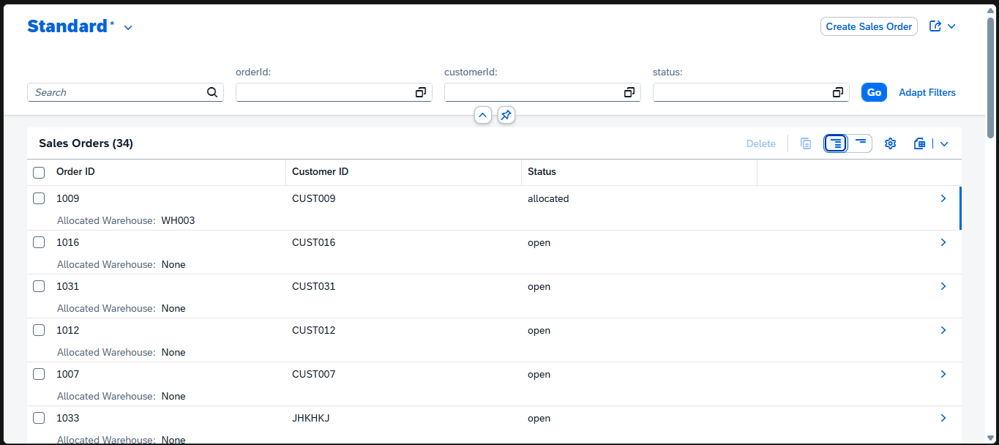
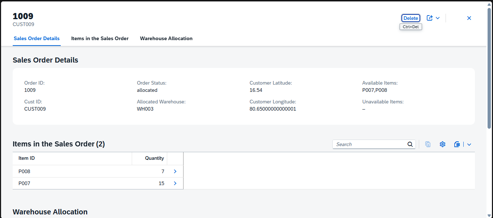
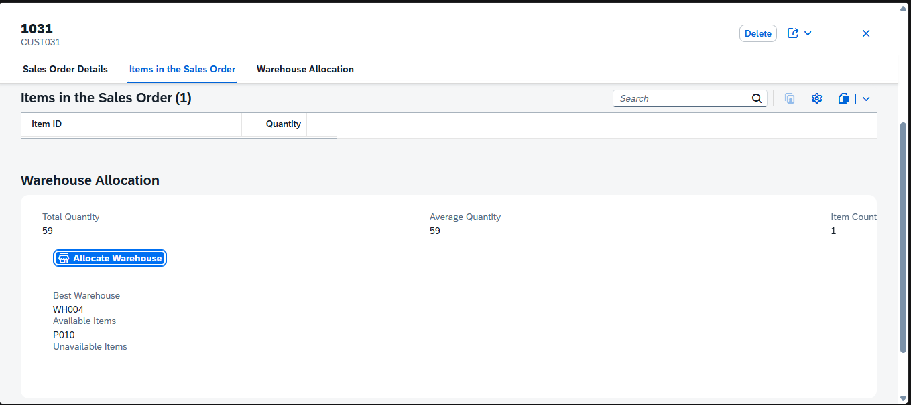
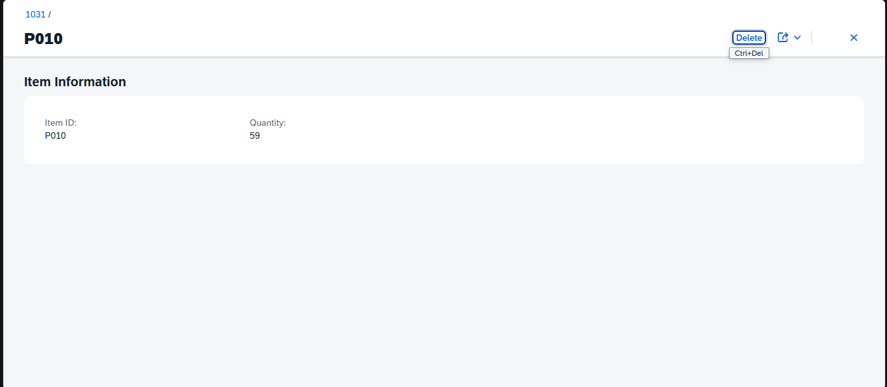
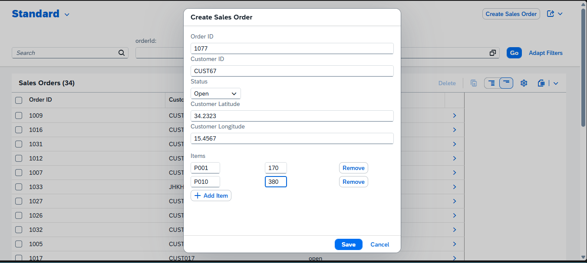

# SmartWarehouse — SAP CAPm

A warehouse management application built using **SAP Cloud Application Programming Model (CAPm)** and **SAP Fiori Elements**. The application identifies the best warehouse for a sales order based on item availability and driving distance, then updates stock during allocation.

## Features

- **Sales Order Management** — View and create sales orders with customer details, coordinates, and items.
- **Fiori Elements UI** — List Report and Object Page layouts generated using CDS annotations.
- **Freestyle UI5 Extensions** — Custom Sales Order creation dialog and warehouse allocation section.
- **Warehouse Selection** — Selects a warehouse that can supply the highest number of requested items.
- **Distance Calculation** — Uses the [OSRM Routing API](https://project-osrm.org/) to compare driving distances from warehouses to the customer.
- **Stock Management** — Deducts allocated quantities and deletes warehouse stock records when stock reaches zero.
- **Allocation Summary** — Displays total quantity, average quantity, item count, selected warehouse, available items, and unavailable items.
- **OData V4** — Exposes backend entities and actions through an OData V4 service.

## Tech Stack

- SAP Cloud Application Programming Model (CAPm)
- Node.js
- CDS (Core Data Services)
- SAP Fiori Elements
- SAPUI5 Freestyle Extensions
- OData V4
- SQLite for local development
- SAP HANA for production deployment
- OSRM Routing API
- SAP Cloud Foundry and MTA deployment tooling

## Application Architecture

```text
SAP Fiori Elements / SAPUI5
           |
           | OData V4
           v
      WarehouseService
           |
           v
     CAP Backend
           |
           +---- Sales Orders
           |
           +---- Items
           |
           +---- Warehouse Stock
           |
           +---- OSRM Routing API
```

## Warehouse Allocation Workflow

1. Open a Sales Order from the List Report.
2. Review the order details and requested items.
3. Click **Allocate Warehouse**.
4. The backend retrieves the Sales Order and its items.
5. It checks warehouse stock to determine which warehouses can supply each requested item in full.
6. It identifies the warehouse or warehouses with the highest item coverage.
7. OSRM calculates driving distances from the customer to those candidate warehouses.
8. The nearest candidate warehouse is selected.
9. Available item quantities are deducted from its stock.
10. Stock records reaching zero are deleted.
11. The UI displays the selected warehouse and the available and unavailable items.

**Note:** The current allocation logic selects one warehouse. Items that cannot be supplied by that warehouse are reported as unavailable; the workflow does not automatically split the order across multiple warehouses.

## Data Model

### SalesOrder

Stores sales order information, customer details, coordinates, status, and associated items.

### Item

Stores the item identifier and requested quantity for a Sales Order.

### Warehouse

Stores warehouse identifiers, coordinates, item associations, and available stock.

## Project Structure

```text
SmartWarehouse-SAP_CAPm/
├── app/
│   ├── mta.yaml
│   └── smartwarehouse/
│       ├── annotations.cds
│       ├── ui5.yaml
│       └── webapp/
│           ├── manifest.json
│           ├── annotations/
│           └── ext/
│               ├── controller/
│               └── fragment/
├── db/
│   ├── schema.cds
│   └── data/
│       ├── smartwarehouse-SalesOrder.csv
│       ├── smartwarehouse-Item.csv
│       └── smartwarehouse-Warehouse.csv
├── srv/
│   ├── warehouse-service.cds
│   └── warehouse-service.js
├── package.json
├── mta.yaml
└── README.md
```

## Prerequisites

- Node.js and npm
- Git
- A modern web browser
- Internet access for OSRM distance calculations

For production deployment, an appropriately configured SAP BTP Cloud Foundry environment and SAP HANA HDI container are required.

## Installation and Setup

### 1. Clone the Repository

```bash
git clone https://github.com/Harikesh-Das/SmartWarehouse-SAP_CAPm.git
cd SmartWarehouse-SAP_CAPm
```

### 2. Install Dependencies

```bash
npm install
```

### 3. Run the Application

Start the application using:

```bash
cds watch
```

Open the frontend URL displayed in the `localhost:4004`.

Keep the terminal running while using the application.

 ### 4. If Frontend is not accessible using `cds watch`

Start the CAP backend in development mode:

```bash
npm run watch
```

The CAP server normally runs at:

```text
http://localhost:4004
```

## 5. Run the Fiori Frontend

Open a second terminal from the project root:

```bash
cd app
npm install
npm run start:smartwarehouse
```

This starts the CAP development server and, with the configured UI5 plugin, launches the Fiori frontend.

The backend is available at:

```text
http://localhost:4004
```

Keep the terminal running while using the application.

## OData Service

The service is defined in:

- `srv/warehouse-service.cds`
- `srv/warehouse-service.js`

The service exposes Sales Orders, Items, and Warehouse entities, together with the `getBestWarehouse` action.

With the backend running, open:

```text
http://localhost:4004/odata/v4/warehouse/
```

The service metadata is available at:

```text
http://localhost:4004/odata/v4/warehouse/$metadata
```

## External API

**OSRM — Open Source Routing Machine**

The application uses the OSRM Table API to retrieve driving distances between the customer and candidate warehouses.

Endpoint used by the application:

```text
https://router.project-osrm.org/table/v1/driving/
```

The public OSRM server is used for development and experimentation. Its availability and usage limits are not guaranteed.

## Database Configuration

Local development uses SQLite through the CAP development configuration.

Production configuration uses SAP HANA. Production deployment requires the relevant SAP BTP services and environment configuration.

Sample CSV data is provided under `db/data/`.

## Deployment

The project includes MTA deployment configuration in `mta.yaml` and `app/mta.yaml`.

For SAP BTP deployment, configure the required Cloud Foundry space and SAP HANA HDI container, then build and deploy the MTA using the SAP build and deployment tools.

Deployment requires a properly configured SAP BTP environment; the presence of MTA files alone does not deploy the application.

## Future Enhancements

- Make the unavailable items available for customer sales order after warehouse allocation.
- Split orders across multiple warehouses by finding nearest warehouse/'s with maximum unavailable items .
- Generate inter warehouse sales order and purchase orders for unavailable items.
- Add shipment and delivery management.
- Improve stock validation and transactional handling.

## Screenshots

**1. Sales Order List Report**


**2. Sales Order Object Page**


**3. Warehouse Allocation**


**4. Item Object Page**


**5. Create Sales Order**



## Author

**Harikesh Das**

GitHub: [Harikesh-Das](https://github.com/Harikesh-Das)

## License

No license has been specified. Contact the repository owner for permission to reuse or distribute the project.
